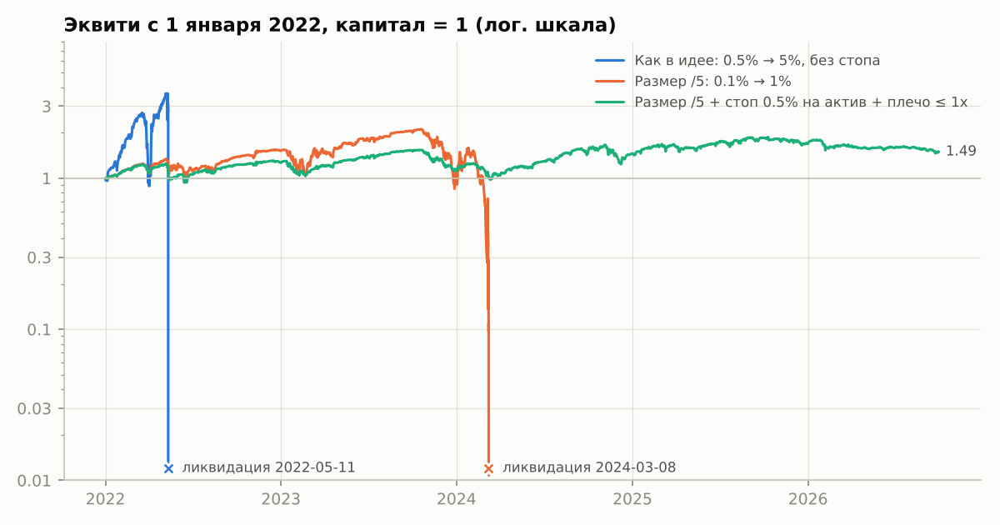
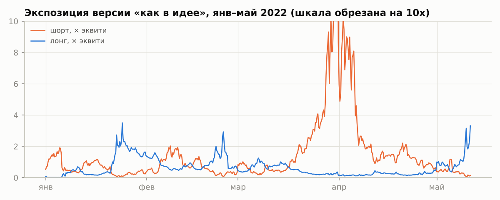
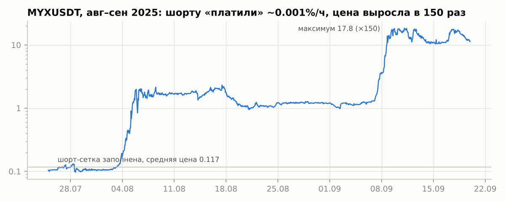

# Сеточный робот «по фандингу»: бэктест идеи

**Идея.** Сеточный робот на 100 активах. Стартовая позиция 0.5% депозита, максимум 5% на актив.
Торгуем только в ту сторону, которой платят фандинг, чтобы долго сидеть в позиции было выгодно.
На отскоке часть позиции сбрасываем.

**Вердикт.** В таком виде робот обнуляет счёт. На истории Binance (2021–2026, топ-100 перпетуалов,
с делистингами, комиссиями и фандингом) это происходит при старте в любом году — от 9 дней до 7 месяцев
после запуска. Ни один параметр сетки этого не исправляет. Причина в самой конструкции, подробности ниже.
Счёт выживает только при жёстких лимитах: позиции в 5 раз меньше, стоп на актив, плечо ≤ 1x. Тогда
результат порядка +5…+15% годовых при просадках 20–45%. Это не лучше простого дельта-нейтрального сбора
фандинга.

## Коротко

- **Бот почти всегда в шорте альтов.** На Binance фандинг в спокойном рынке ровно +0.01% за 8 ч, и
  платят шортам. В 2021–2026 так было 77% времени (в 2021 году 90%). Получается сетка в шорт
  на 100 альтов, которая время от времени переворачивается в лонг на падающих монетах.
- **Сторона, которой платят, — это сторона против толпы и тренда.** За 30 дней шорт при положительном
  фандинге в медиане зарабатывает: альты медленно дешевеют. В среднем он теряет: редкие сквизы съедают
  всё. При фандинге выше 0.1%/8ч шорт теряет в среднем 31% номинала за 30 дней, а фандинга получает 2.9%.
- **100 активов — это не 100 независимых ставок.** Средняя корреляция дневных доходностей 0.5–0.6.
  В худшие 5% дней падают 95–98% монет. Все сетки добираются до максимума одновременно: за сутки до
  ликвидации позиции достигали 6–9 депозитов.
- **Одна монета способна обнулить счёт даже при лимите 0.5% на актив.** MYX в августе–сентябре 2025:
  шорту «платили» около 0.001% в час (так было в 78% расчётов), цена выросла в 150 раз, а в пиках
  сквиза шорт сам платил до 2% в час.
- **Не помогают:** шаг 2% / 5% / от волатильности, порог по фандингу, выход при развороте фандинга,
  только лонги или только шорты, лимит плеча 2x, позиции в 5–10 раз меньше без стопа,
  рыночно-нейтральная версия (лонг 20 самых «отрицательных» и шорт 20 самых «положительных»).
- **Выживает:** 0.1% → 1% на актив, стоп 0.5% депозита на актив, суммарная позиция ≤ 1 депозита.
  Это порядка +5…+15% годовых при просадке 20–45%. Соседние значения параметров дают в медиане
  около 0…+6%, то есть устойчивого преимущества нет. Фильтр по фандингу при этом полезен: против
  торговли «против фандинга» он добавляет 15–20 п.п. годовых.
- **Ориентир:** дельта-нейтральный сбор фандинга (шорт перпа и лонг спота на 10–20 монетах
  с максимальным фандингом, ребаланс раз в неделю) — около 15% годовых на номинал (≈11% на капитал)
  без ставки на направление цены. В 2022 году он дал около нуля.
- **Не крипта.** На TradFi-перпетуалах Binance (металлы, сырьё, индексы и акции США, декабрь 2025 –
  сентябрь 2026) та же идея дала +4…+6% за период при просадке 2–6%. Выборка короткая, по сути
  один эпизод роста и обвала металлов (п. 6).
  Площадки для валют и металлов сравниваются в п. 6.1.

## 1. Что именно тестировалось

| Правило | Реализация |
|---|---|
| Активы | Топ-100 USDT-M перпетуалов Binance по обороту прошлого месяца, пересчёт ежемесячно. Монета должна торговаться не меньше 600 часов в прошлом месяце. Стейблкоины и индексы исключены. Делистнутые монеты включены, поэтому выборка без ошибки выжившего. |
| Направление | Знак последнего начисленного фандинга: больше нуля — шорт, меньше нуля — лонг. |
| Вход | 0.5% эквити по рынку. |
| Доборы | Каждые 3% против позиции (геометрически от цены входа) ещё 0.5%, максимум 10 лотов, то есть 5%. |
| Сброс на отскоке | Каждый добор закрывается лимиткой на один шаг сетки назад (классическая сетка). Базовый лот держим ради фандинга. |
| Фандинг развернулся или монета выпала из топ-100 | Не доливаем. Базовый лот закрываем в безубыток; если цена за 7 дней не вернулась — закрываем по рынку. Вариант «закрыть сразу» тоже проверен. |
| Риск | Без стопа и без лимита общей позиции, кросс-маржа. Сетка зафиксирована от цены входа; вариант с подтяжкой проверен отдельно. |

## 2. Данные и модель исполнения

- **Данные.** Публичный архив Binance (data.binance.vision): часовые свечи и вся история фандинга
  по 894 USDT-M контрактам с декабря 2020 по сентябрь 2026, включая делистнутые. Для проверки
  точности добавлены 15-минутные свечи (2021–2026) и 5-минутные (2025–2026) по активам юниверса.
- **Комиссии.** Maker 0.02% для лимиток сетки. Taker 0.05% плюс проскальзывание 0.03% для рыночных
  входов, выходов и стопов.
- **Фандинг.** Начисляется по фактическим ставкам в момент расчёта (интервалы 1, 4 и 8 ч) на позицию,
  открытую к этому моменту. Решение о направлении принимается по уже начисленной ставке, без
  заглядывания вперёд.
- **Путь цены внутри свечи.** Путь А: бычья свеча идёт O→L→H→C, медвежья O→H→L→C. Путь Б: сначала
  в сторону позиции, потом против. Разница результатов А и Б показывает, насколько точна модель
  (см. п. 3.5).
- **Делистинг или разрыв данных больше 24 ч.** Позиция принудительно закрывается по последней цене.
- **Ликвидация.** Эквити в худшей точке часа (все активы одновременно в худших экстремумах) опускается
  ниже 1% от суммарной позиции. Проверено и без этого допущения: эквити по закрытиям часов уходит ниже
  нуля в те же дни.
- **Проверка движка.** Бухгалтерия (кэш + реализованное + фандинг − комиссии + нереализованное)
  сверяется на синтетических рядах в `test_sim.py`.

## 3. Результаты

### 3.1. Кому платят фандинг

Доля времени по активам топ-100 (взвешено по длине интервала фандинга):

| Год | Платят шортам (фандинг > 0) | из них ровно +0.01%/8ч | Платят лонгам (фандинг < 0) |
|---|---|---|---|
| 2021 | 90% | 48% | 10% |
| 2022 | 65% | 46% | 34% |
| 2023 | 84% | 59% | 15% |
| 2024 | 88% | 54% | 12% |
| 2025 | 70% | 48% | 29% |
| 2026 (9 мес.) | 62% | 31% | 31% |
| **Всего** | **77%** | **48%** | **22%** |

Ставка Binance: фандинг = премия + clamp(0.01% − премия, ±0.05%). Пока перп торгуется почти без
премии к споту, ставка ровно +0.01% за 8 ч, это ≈11% годовых на номинал в пользу шорта. Поэтому
правило «торгуем туда, где платят» на практике означает «шортим альты».

### 3.2. Сторона, которой платят, без сетки

Каждый расчёт фандинга по активу из топ-100 считается сделкой на стороне, которой платят. Ниже то, что
дают цена и фандинг за следующие **30 дней** (на 1 и 7 дней — в `results/stats.log`):

| Фандинг за 8 ч | Сторона | Цена, среднее | Цена, медиана | Фандинг получен | Итого, среднее | Доля в плюсе |
|---|---|---|---|---|---|---|
| < −0.1% | лонг | −9.9% | −17.3% | +15.6% | +5.7% | 42% |
| −0.1…−0.03% | лонг | −2.4% | −9.0% | +3.4% | +1.0% | 40% |
| −0.03…−0.01% | лонг | −0.4% | −5.7% | +1.2% | +0.8% | 41% |
| −0.01…0% | лонг | −0.4% | −4.7% | +0.5% | +0.1% | 41% |
| ровно +0.01% | шорт | −0.7% | +7.4% | +0.3% | −0.4% | 62% |
| +0.01…+0.03% | шорт | −4.5% | +8.6% | +1.7% | −2.8% | 62% |
| +0.03…+0.1% | шорт | −7.9% | +10.2% | +2.5% | −5.4% | 64% |
| > +0.1% | шорт | −33.6% | −0.7% | +2.9% | −30.7% | 54% |

Медиана у шорта положительная, а среднее отрицательное. Это профиль продажи хвостового риска: чаще
выигрываешь понемногу, иногда проигрываешь очень много. Фандинг (0.3–2.9% за месяц) этого не
компенсирует. Высокий положительный фандинг — признак идущего сквиза, а не подарок. Лонгам на сильно
отрицательном фандинге платят действительно много, но цена в медиане падает ещё сильнее, и в плюсе
меньше половины случаев.

### 3.3. Идея как есть

| Старт | Пик эквити | Ликвидация | Что было за сутки до | Что произошло |
|---|---|---|---|---|
| 01.2021 | ×1.01 | 09.01.2021 | шорт 6.3 депозита, 36 сеток на максимуме | январское ралли альтов |
| 01.2022 | ×3.67 (07.05.2022) | 11.05.2022 | лонг 1.8 депозита | фандинг ушёл в минус, сетки перевернулись в лонг прямо перед обвалом LUNA |
| 01.2023 | ×1.02 | 14.01.2023 | шорт 6.6 депозита | январское ралли 2023 |
| 01.2024 | ×1.43 | 02.03.2024 | шорт 9.1 депозита | ралли февраля–марта 2024 (PEPE и мемы) |
| 01.2025 | ×4.26 (02.08.2025) | 05.08.2025 | шорт 2.2 депозита | MYX вырос в 17 раз за 3 дня |







Типичная картина: несколько месяцев сетка красиво зарабатывает на откатах (с января 2022 года
×3.7 за четыре месяца), потом одно коррелированное движение рынка за несколько дней доводит
десятки сеток до максимума, и счёт обнуляется.

### 3.4. Вариации

💥 ММ.ГГГГ — ликвидация. Иначе — среднегодовая доходность / максимальная просадка до конца сентября
2026. Часовые свечи, путь А.

| Вариант | старт 2021 | старт 2022 | старт 2023 | старт 2024 | старт 2025 |
|---|---|---|---|---|---|
| Как в идее: 0.5% → 5%, шаг 3%, без стопа | 💥 01.2021 | 💥 05.2022 | 💥 01.2023 | 💥 03.2024 | 💥 08.2025 |
| Шаг 2% | 💥 01.2021 | 💥 03.2022 | 💥 01.2023 | 💥 03.2024 | 💥 08.2025 |
| Шаг 5% | 💥 01.2021 | 💥 05.2022 | 💥 01.2023 | 💥 03.2024 | 💥 08.2025 |
| Шаг 0.5 дневной волатильности | 💥 02.2021 | 💥 05.2022 | 💥 11.2023 | 💥 03.2024 | 💥 08.2025 |
| Только лонги | 💥 05.2021 | 💥 01.2022 | 💥 08.2024 | 💥 08.2024 | 💥 02.2025 |
| Только шорты | 💥 01.2021 | 💥 12.2023 | 💥 01.2023 | 💥 03.2024 | 💥 08.2025 |
| Разворот фандинга → закрыть сразу | 💥 01.2021 | 💥 01.2023 | 💥 01.2023 | 💥 03.2024 | −33% / −92% |
| Порог: фандинг по модулю > 0.01% | 💥 01.2021 | 💥 05.2022 | 💥 12.2023 | 💥 03.2024 | 💥 02.2025 |
| Порог: фандинг по модулю > 0.03% | 💥 01.2021 | 💥 05.2022 | 💥 02.2024 | 💥 03.2024 | 💥 04.2025 |
| Сетка подтягивается за ценой | 💥 01.2021 | 💥 05.2022 | 💥 01.2023 | 💥 02.2024 | 💥 08.2025 |
| Плечо ≤ 2x | 💥 01.2021 | 💥 12.2023 | 💥 01.2023 | 💥 11.2024 | 💥 08.2025 |
| Размер /5: 0.1% → 1% | 💥 02.2021 | 💥 03.2024 | 💥 03.2024 | 💥 09.2025 | 💥 09.2025 |
| Размер /10: 0.05% → 0.5% | 💥 03.2021 | 💥 09.2025 | 💥 09.2025 | 💥 09.2025 | 💥 09.2025 |
| Нейтральный 20/20 | 💥 02.2021 | 💥 03.2024 | 💥 03.2024 | 💥 12.2024 | 💥 08.2025 |
| Стоп 2% эквити на актив | −42% / −97% | −13% / −85% | −28% / −85% | −14% / −82% | −34% / −78% |
| Стоп 2% + плечо ≤ 2x | −35% / −97% | −2% / −87% | −23% / −87% | +1% / −78% | +1% / −67% |
| **Размер /5 + стоп 0.5% + плечо ≤ 1x** | +2% / −45% | +9% / −37% | +0% / −37% | +10% / −26% | +2% / −23% |
| то же, сетка подтягивается | −28% / −86% | −11% / −63% | −24% / −65% | −20% / −55% | −20% / −55% |
| то же, путь внутри свечи Б | +23% / −37% | +26% / −32% | +17% / −32% | +30% / −23% | +22% / −14% |
| Нейтральный 20/20, /5 + стоп 0.5% + 1x | −1% / −27% | +0% / −27% | −3% / −27% | −4% / −27% | −13% / −27% |
| Контроль: против фандинга | 💥 05.2021 | 💥 01.2022 | 💥 06.2023 | 💥 06.2024 | 💥 02.2025 |
| Контроль: всегда шорт | 💥 01.2021 | 💥 11.2023 | 💥 01.2023 | 💥 03.2024 | 💥 08.2025 |
| Контроль: всегда лонг | 💥 04.2022 | 💥 01.2022 | 💥 07.2024 | 💥 07.2024 | 💥 02.2025 |
| Контроль к /5 + стоп + 1x: против фандинга | −15% / −76% | −21% / −74% | −20% / −68% | −24% / −67% | −33% / −59% |
| Контроль к /5 + стоп + 1x: всегда шорт | −10% / −55% | −0% / −28% | −10% / −46% | +3% / −21% | +8% / −10% |
| Контроль к /5 + стоп + 1x: всегда лонг | −7% / −72% | −14% / −59% | −7% / −51% | −12% / −51% | −25% / −50% |

Ещё три наблюдения:

- Стоп 2% на актив не спасает портфель. При 100 коррелированных позициях это до 200% депозита
  в одном движении.
- Даже при 0.05% → 0.5% на актив счёт при старте с 2022 года обнуляет один MYX: шорт держался,
  пока цена росла в 150 раз.
- «Сетка подтягивается за ценой» хуже фиксированной. После сильного движения сетка заново
  набирается от экстремума, и стопы срабатывают чаще.

### 3.5. Точность: размер свечи и путь внутри неё

Для исходной идеи всё однозначно: ликвидации в те же дни на 1h, 15m и 5m при обоих путях
(`results/exp15.log`, `results/exp5.log`). Для версии со стопами результат зависит от того, сколько
колебаний сетка ловит внутри свечи. С уменьшением свечи пути А и Б сходятся. Старт 01.2025,
доходность / просадка:

| Вариант | 1h, А | 1h, Б | 15m, А | 15m, Б | 5m, А | 5m, Б |
|---|---|---|---|---|---|---|
| /5 + стоп 0.5% + плечо ≤ 1x | +2% / −23% | +22% / −14% | +4% / −22% | +19% / −18% | +6% / −22% | +16% / −20% |
| то же, против фандинга | −33% / −59% | −21% / −49% | −27% / −54% | −20% / −47% | −24% / −50% | −19% / −46% |
| то же, всегда шорт | +9% / −10% | +20% / −6% | +12% / −7% | +20% / −6% | +15% / −7% | +20% / −6% |
| то же, всегда лонг | −25% / −50% | −10% / −43% | −22% / −51% | −13% / −44% | −22% / −52% | −17% / −48% |

Реалистичная оценка лежит между А и Б на мелкой свече: для этой версии около +10% годовых
в 2025–2026 годах. Обратите внимание: в 2025–2026 «всегда шорт» с теми же лимитами был не хуже,
потому что это был медвежий рынок альтов.

На всём периоде с 01.2021 (15m) версия «/5 + стоп 0.5% + 1x» даёт +5% (путь А) и +17% (путь Б)
при просадке около 40%. Контроль «против фандинга» даёт −11% / −5%, «всегда шорт» −8% / −3%,
«всегда лонг» −5% / 0%. 27 комбинаций (лот 0.05/0.1/0.2%, стоп 0.25/0.5/1%, плечо 0.5/1/2x)
на 15m дают медиану −0.4% годовых (диапазон −6…+6%) для пути А и +6% (−4…+26%) для пути Б при
медианной просадке 40–43% (`results/sweep_15m_path*.log`). Выбранная точка — одна из лучших,
устойчивого плато нет.

### 3.6. Ориентир: дельта-нейтральный сбор фандинга

Шорт перпа и лонг спота на K монетах из топ-100 с максимальным положительным фандингом за прошлую
неделю. Держим, пока монета в топ-2K; ротация стоит 0.3% номинала. Базис и доступность спота не
моделируются (`carry.py`).

| K | Годовых на номинал | 2021 | 2022 | 2023 | 2024 | 2025 | 2026 (9 мес.) |
|---|---|---|---|---|---|---|---|
| 10 | 15.7% | 48% | −4% | 6% | 22% | 10% | 9% |
| 20 | 14.9% | 48% | −1% | 7% | 18% | 4% | 9% |
| 50 | 12.7% | 44% | −1% | 9% | 17% | 3% | 2% |

На капитал (спот плюс маржа перпа при плече 3x) это примерно в 1.33 раза меньше. Без направленного
риска это сопоставимо с лучшей «подстрахованной» сеткой, у которой просадки 20–45%.

## 4. Почему так

1. **Фандинг — плата за риск.** Платят той стороне, которую рынок держать не хочет. Положительный
   фандинг высокий, когда монету покупают с плечом, то есть во время роста. Отрицательный — когда её
   массово шортят, то есть во время падения, разлоков или перед делистингом. Торговать «туда, где
   платят» значит торговать против тренда и докупать по сетке против него.
2. **Масштаб.** Базовые 0.01%/8ч — это 11% годовых на номинал. На позиции 5% это 0.55% депозита
   в год. Рост монеты в 1.5 раза на той же позиции стоит 2.5% депозита, рост в 150 раз (MYX) —
   7.5 депозита.
3. **Корреляция.** Средняя попарная корреляция дневных доходностей топ-100 в 2021–2025 годах
   0.50–0.62. В худшие 5% дней падают 95–98% монет, в среднем на 8–15%. Сто сеток в одну сторону —
   одна большая позиция с плечом до 5x.
4. **Асимметрия сетки.** Сброс на отскоке фиксирует маленькую прибыль с дешёвых лотов, а убыток
   базовой позиции и ранних лотов остаётся. Кривая растёт плавно, пока тренд не продолжится.

## 5. Если всё-таки строить робота

То, без чего он не выживает на истории:

- **Размер:** не больше 1% на актив на максимуме и не больше 1 депозита суммарно. Лучше считать
  риск портфеля, а не каждого актива: сколько потеряем, если все позиции одновременно уйдут на
  30–50% против нас.
- **Жёсткий стоп на актив** (в бэктесте 0.5% депозита) и **общий стоп по просадке портфеля**.
  Стоп на актив не защищает от движения всего рынка.
- **Ограничение чистой позиции.** Бот почти всегда в шорте альтов, нужен лимит на net (например,
  ±30–50% депозита) или хедж через BTC/ETH.
- **Фильтры монет.** Без свежих листингов, без неликвида, без монет с фандингом выше 0.1%/8ч:
  это обычно идущий сквиз. Без монет с риском делистинга.
- **Фиксированная сетка** от цены входа, без подтяжки. Тайм-стоп для «зависших» позиций.
- **Исполнение:** лимитки (maker), учёт интервала фандинга 1/4/8 ч, лимитов позиций и ступеней
  маржи биржи. Стопы во флеш-крэшах (10.10.2025) исполняются хуже стоп-цены.
- **Проверка** на 1–5-минутных данных и бумажная торговля до реальных денег.

Даже со всем этим на истории это +5…+15% годовых при просадках 20–45%. Если цель — доход от
фандинга, дельта-нейтральная схема из п. 3.6 даёт сопоставимую доходность без ставки на направление.

## 6. Не крипта: металлы, сырьё, индексы и акции

### 6.1. Где торговать

| Площадка | Что есть | «Фандинг» | Издержки и API | Минусы |
|---|---|---|---|---|
| **Binance, TradFi-перпетуалы** | золото, серебро, платина, палладий, медь, газ, SPY, QQQ, акции США | фандинг каждые 8 ч, как у криптоперпов; по золоту и серебру ограничен ±0.05% за расчёт | комиссии как у криптофьючерсов, API, по золоту и серебру около $1 млрд оборота в день | криптобиржа (расчёты в USDT), валютных пар нет, история только с декабря 2025 |
| **Interactive Brokers** | валюты, металлы, индексы, сырьё (CFD и фьючерсы) | валюта: разница ставок ± 1% годовых (± 0.5% на крупных счетах); индексы: ставка ± 1.5% | валюта от 0.2 б.п. (минимум $2), API TWS / IB Gateway | минимальная комиссия $2 съедает мелкие лоты, нужен счёт от десятков тысяч $ |
| **Мосбиржа, вечные фьючерсы** | USD/RUB, EUR/RUB, CNY/RUB, золото, серебро (с 31.03.2026), индекс Мосбиржи, несколько акций | фандинг считает биржа раз в день по отклонению от спота, без наценки брокера | брокерские API (Алор, Т-Инвестиции, Финам) | около 10 инструментов, всё против рубля |
| **Фьючерсы CME / ICE / Eurex** | всё из списка из 100 | «фандинг» встроен в цену контракта, наценки нет | комиссия около $1–2 за контракт | контракты крупные, нужен счёт от сотен тысяч $ |
| **CFD-брокеры (например, Pepperstone)** | всё из списка из 100 | валюта и металлы: TomNext плюс комиссия брокера; индексы и сырьё: ставка ± 2.5% годовых | MT5, cTrader | наценка 2.5% съедает «фандинг» на индексах и сырье |

Источники: [IBKR, CFD на валюту](https://ibkb.interactivebrokers.com/de/node/3030),
[IBKR, спот-золото](https://www.financemagnates.com/forex/brokers/interactive-brokers-launches-trading-services-with-us-spot-gold/),
[Pepperstone, свопы](https://pepperstone.com/en/ways-to-trade/pricing/),
[Мосбиржа, индикативный фандинг](https://www.moex.com/n55462?nt=112),
[Мосбиржа, серебро](https://www.moex.com/n98755),
[Мосбиржа, вечные фьючерсы](https://profile.ru/news/finance/mosbirzha-zapustit-vechnye-kontrakty-na-amerikanskie-indeksy-s-p-500-i-nasdaq-1885299/),
[Binance TradFi, запуск](https://www.theblock.co/news/markets/2026-01-08-binance-gold-silver-perpetual-contracts-usdt-settled-384743).

### 6.2. Проверка на TradFi-перпетуалах Binance

Это единственная из площадок, по которой история цен и фандинга доступна из среды, где делался
бэктест. Остальные источники (Dukascopy, FRED, BIS, Мосбиржа) закрыты её сетевыми настройками.
Взяты 15 инструментов: металлы и сырьё (6), SPY, QQQ и 7 крупных акций США. Без токенизированного
золота, плечевых ETF и акций криптокомпаний. Период — с листинга каждого (декабрь 2025 – апрель 2026)
по сентябрь 2026. Модель та же, часовые свечи, путь А (`build_tradfi.py`, `exp_tradfi.py`,
`results/exp_tradfi.log`).

Доходность за весь период (не годовая) / максимальная просадка:

| Вариант | Металлы и сырьё (6) | Все 15 |
|---|---|---|
| Как в идее: 0.5% → 5%, шаг 3% | +4.4% / −1.9% | +5.5% / −3.2% |
| Шаг 1% | +6.2% / −2.9% | +5.2% / −5.9% |
| Шаг 2% | +5.7% / −2.3% | +6.4% / −4.3% |
| Шаг 0.5 дневной волатильности | +4.2% / −1.9% | +5.1% / −4.1% |
| Шаг 1% + стоп 2% на актив | +3.8% / −2.8% | +2.9% / −5.9% |
| Контроль: против фандинга | −2.7% / −4.1% | −1.2% / −5.5% |
| Контроль: всегда шорт | +3.5% / −2.0% | +2.3% / −3.8% |
| Контроль: всегда лонг | −0.1% / −3.1% | +1.8% / −3.9% |

- Платили почти всегда шортам. Лонги за период заплатили по золоту 10.6% номинала, по серебру 15.6%,
  по платине 11.7%, по палладию 13.6%, по газу 21.1%. Поэтому бот в основном шортил металлы.
- Металлы сначала резко выросли (золото до $5625, серебро до $122), потом упали (серебро −24%,
  платина −26%, палладий −34% за период). Шорт-сетки пересидели рост и заработали на падении.
- Средняя позиция всего 0.1–0.3 депозита: инструментов 6–15, а не 100, и фандинг часто ровно ноль
  (тогда бот не входит). Отсюда маленькие и доходность, и просадки.
- Против фандинга результат хуже на 3–7 п.п., то есть фильтр работает. Но заметная часть результата —
  просто шорт падающих металлов: «всегда шорт» дал +2…+3.5%.
- Это 10 месяцев и по сути один эпизод: рост металлов и обвал. Выводов о надёжности отсюда не
  сделать. Для этого нужна длинная история валют, металлов и индексов со свопами (Dukascopy и ставки
  ЦБ) и история Мосбиржи. Их источники в среде бэктеста закрыты.

## 7. Ограничения бэктеста

- Одна биржа (Binance USDT-M). На других биржах фандинг и состав монет отличаются.
- Стопы исполняются по стоп-цене плюс 0.03%. В реальных обвалах исполнение хуже, то есть результаты
  версий со стопами оптимистичны.
- Не моделируются автоделевередж, ступени маржи, лимиты позиций и задержки API.
- Сетка внутри свечи упрощена (см. п. 3.5). Для исходной идеи это не важно, для версий со стопами
  даёт неопределённость около ±5–10 п.п. годовых.
- Юниверс определяется по обороту прошлого месяца. Выбор других 100 монет даст другие цифры, но не
  другую картину.

## 8. Как воспроизвести

```bash
cd funding-grid
pip install -r requirements.txt
python3 list_symbols.py && python3 list_files.py   # список контрактов и файлов в архиве
python3 download.py && python3 build.py            # 1h-свечи + фандинг → data/panel.npz (~15 мин)
python3 test_sim.py                                # проверка бухгалтерии движка
python3 stats.py > results/stats.log               # распределение фандинга, п. 3.1–3.2
python3 carry.py > results/carry.log               # ориентир cash & carry, п. 3.6
python3 experiments.py                             # все вариации, п. 3.4 (results_all.json)
python3 summarize.py                               # таблица п. 3.4
python3 charts.py                                  # графики в report/
# точность (п. 3.5): 15m- и 5m-свечи
python3 download15.py && python3 build15.py && python3 exp15.py
python3 download5.py && python3 build5.py && python3 exp5.py
python3 sweep.py 15m 0 && python3 sweep.py 15m 1
# TradFi-перпетуалы Binance (п. 6.2), данные берутся из того же архива
python3 build_tradfi.py && python3 exp_tradfi.py
```

Движок — `sim.py` (numba). Параметры по умолчанию — `BASE` в `run.py`. Разобрать отдельный прогон
можно через `diag.py`, например `python3 diag.py 2022-01-01 "lot_pct=0.001"`.
